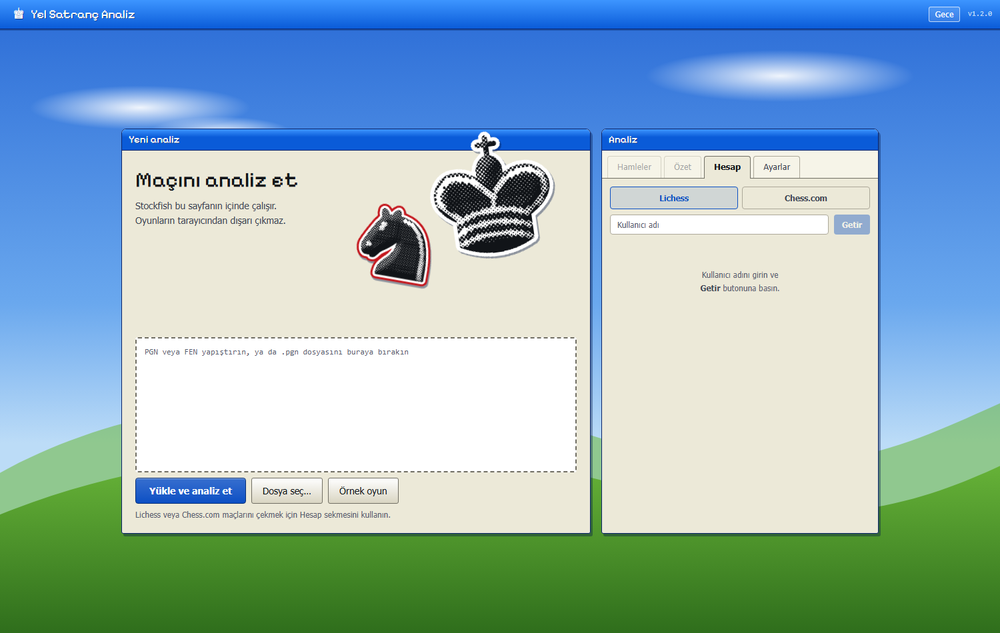
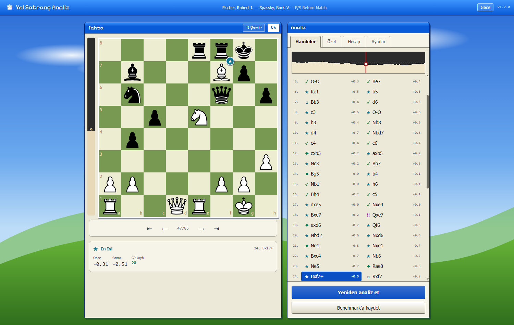

# Yel Satranç Analiz

Açık kaynaklı satranç motoruyla (Stockfish) maçlarınızı **kendi bilgisayarınızda, ücretsiz** analiz eden bir web uygulaması. PGN, FEN veya `.pgn` dosyası yükleyin; her hamle motorla değerlendirilir, sınıflandırılır ve oyun özeti çıkarılır. Sunucu yok: motor tarayıcınızda bir Web Worker olarak çalışır.





## Özellikler

- **Tam oyun analizi** — PGN yapıştırın ya da `.pgn` dosyası seçin/sürükleyin. Çok oyunlu dosyalarda ilk oyun yüklenir. `[FEN]` başlıklı (özel başlangıç pozisyonlu) oyunlar desteklenir.
- **FEN analizi** — tek bir pozisyon için değerlendirme ve en iyi 3 hamle.
- **Hamle sınıflandırma** — Kusursuz · Muhteşem · En İyi · Mükemmel · İyi · Hamle(?!) · Yanılgı · Gaf (kazanma olasılığı kaybına göre, aşağıya bakın).
- **Tahta** — değerlendirme çubuğu, tahtayı çevirme (`F`), daha iyi hamle oku, hamle rozetleri, ok tuşlarıyla gezinme.
- **Maç özeti** — doğruluk, ACPL, tahmini rating ve açılış / orta oyun / oyun sonu dökümü.
- **Hesap analizi** — Lichess veya Chess.com kullanıcı adınızla son 15 maçı çekin, tek tıkla hepsini analiz edip ortalama performansınızı görün.
- **Analiz geçmişi** — biten analizler tarayıcıda saklanır (en çok 50), listeden tek tıkla açılır.
- **Benchmark** — aynı maçı birden çok kez analiz edip motorun tutarlılığını ölçün.
- **Performans ayarları** — motor (Stockfish 18 / Lite), derinlik (8–24), paralel işçi sayısı, hash belleği. Tek iş parçacıklı WASM motor, pozisyonları işçilere dağıtarak paralelleştirilir.
- **Değerlendirme grafiği** — hamle hamle kimin üstün olduğunu gösterir; tıklayınca o pozisyona gider.
- **Görünüm** — Windows XP "Bliss" masaüstü havasında iki tema (gündüz / gece). Açılıştaki halftone sticker taşlar projenin kendi taş SVG'lerinden tarayıcıda üretilir; hazır görsel indirilmez. Ayrıca 8 tahta rengi, 5 taş seti, 4 yazı tipi ve tahta boyutu seçilebilir.

## Gizlilik

Analiz tamamen tarayıcınızda yapılır; oyunlarınız hiçbir sunucuya gönderilmez. Ağ istekleri yalnızca şunlardır:

- Motor ve site dosyaları (aynı siteden, ilk açılışta; Stockfish 18 yaklaşık **113 MB**, Lite yaklaşık **7 MB** — tarayıcı önbelleğe alır).
- **Hesap** sekmesinde "Getir"e bastığınızda doğrudan `lichess.org` veya `api.chess.com`'a yapılan oyun listesi istekleri.

Analitik, takip veya üçüncü taraf yazı tipi isteği yoktur (yazı tipleri siteyle birlikte sunulur). Ayarlar, kullanıcı adları, analiz geçmişi ve benchmark kayıtları yalnızca tarayıcınızın `localStorage` alanında tutulur; "site verilerini temizle" ile silinir.

## Başlarken

```bash
npm install        # bağımlılıklar + Stockfish dosyalarını public/stockfish/ altına kopyalar
npm run dev        # geliştirme sunucusu: http://localhost:5173
npm run build      # tip kontrolü + üretim derlemesi (dist/)
npm run lint       # oxlint
npm test           # vitest birim testleri
```

Node.js 20 veya üzeri önerilir (CI Node 24 kullanır).

## Nasıl çalışır?

1. Her pozisyon (başlangıç + her hamleden sonrası) motora bir kez sorulur: `go depth N`, MultiPV 2 (FEN modunda 3).
2. Bir hamlenin kalitesi, hamle öncesi ve sonrası değerlendirmenin **kazanma olasılığına** çevrilmiş farkıdır (Lichess'in sigmoid modeli). Eşikler `src/lib/classification.ts` içindeki `CLASSIFICATION_THRESHOLDS`'tadır:

   | Kazanma olasılığı kaybı | Sınıf |
   |---|---|
   | ≤ %2 | Mükemmel |
   | ≤ %5 | İyi |
   | ≤ %10 | Hamle(?!) |
   | ≤ %20 | Yanılgı |
   | > %20 | Gaf |

   Motorun seçtiği hamle "En İyi" sayılır; ikinci en iyi hamle en az %10 (Muhteşem) veya %20 (Kusursuz) kaybettiriyorsa o sınıfa yükselir.
3. **ACPL** (ortalama santipiyon kaybı) hesabında her değerlendirme ±1000 cp'ye kırpılır (mat dahil), böylece tek bir kaçırılmış mat ya da zaten kazanılmış bir pozisyondaki büyük sayılar ortalamayı bozmaz.
4. **Performans tahmini** (`src/lib/performance/`) gerçek oyunlarla kalibre edilmiştir ve her zaman %80 aralıkla gösterilir. Üç yöntem vardır:
   - **Doğruluk**: kitap (ilk 5 hamle), zorunlu ve kararlı pozisyon (|değer| ≥ 400 cp) hamleleri çıkarılır; kalanların Lichess doğruluğu rating'e çevrilir.
   - **ACPL**: aynı filtreden geçmiş ortalama kayıp.
   - **Sonuçlar (PR)**: klasik performans rating'i, yani ortalama rakip + 400·log10(S/(1−S)).

   **Birleşik** tahmin, doğruluk ve PR'nin ölçülen hatalara göre ağırlıklı ortalamasıdır. Yalnızca ikisi aynı ölçekteyken hesaplanır.

   **Site dönüşümü (Chess.com ↔ Lichess)**: Doğruluk modeli Lichess rating'leriyle kalibre edildiği için Chess.com hesaplarında doğruluk tahmini Chess.com ölçeğine çevrilir. Dönüşümün kendi hatası aralığa eklenir. Her tahminin yanında diğer sitedeki karşılığı gösterilir.

   Dönüşüm şöyle ölçüldü: iki sitenin 2025–26 blitz ve rapid oyunları aynı motorla analiz edildi (Stockfish 18, derinlik 12). Sonra aynı beklenen doğruluğa karşılık gelen rating'ler eşlendi (`scripts/calibrate/scale.mjs`). Bağımsız, aynı oyuncuların iki sitedeki profillerine dayanan [ChessGoals](https://chessgoals.com/rating-comparison/) tablosuyla blitz'te 500–2000 aralığında 30–60 puan içinde uyuşuyor. Örneğin Chess.com blitz 1000 ≈ Lichess 1386 (ChessGoals 1425). FIDE dönüşümü yok, çünkü FIDE için açık oyun verisi yok.

   Katsayılar ve hata payları `calibration.json`'dadır. Bunlar `scripts/calibrate/` ile üretilir: lichess oyuncularının analizli oyunları üzerinde, oyuncu bazlı çapraz doğrulama kullanılır. Ölçülen hata (RMSE) şöyledir:

   | Maç | Doğruluk | PR | Birleşik |
   |---|---|---|---|
   | 1 | ~390 | ~210 | ~200 |
   | 15 | ~260 | ~170 | ~160 |

   Tek maçtan çıkan değer kabadır.
5. **Zaman yönetimi puanı** saat verisi (`[%clk]`) olan oyunlarda hesaplanır. Bileşenleri şunlardır: zaman sıkışması, baskı altında hata artışı, 1 saniyeden kısa hamlelerde hata, kritik pozisyonlara ayrılan süre, açılışa harcanan pay ve kullanılmayan süre. Her bileşen benzer rating'deki oyunculara göre yüzdeliğe çevrilir. Rating tahminine dahil değildir: kalibrasyon verisinde bu göstergeler, rating bilindiğinde oyun kalitesini ya da sonucu açıklamıyor.
6. Üçlü tekrar ve 50 hamle kuralı oyunu bitirmiş sayılmaz (oyuncular devam edebilir); yalnızca mat, pat ve yetersiz materyal sonuç pozisyonudur.

## Proje yapısı

```
src/
├── engine/
│   ├── StockfishService.ts   # Worker üzerinde UCI; Promise tabanlı, hata/zaman aşımı/terminate
│   ├── analyzeGame.ts        # ortak analiz hattı + EnginePool (iptal edilebilir)
│   └── types.ts              # Engine arayüzü, EngineError, AbortError yardımcıları
├── lib/
│   ├── classification.ts     # kazanma olasılığı, sınıflandırma, ACPL
│   ├── performance/          # kalibre rating tahminleri (doğruluk, ACPL, PR, birleşik), zaman yönetimi puanı
│   ├── pgn.ts                # PGN/FEN ayrıştırma, çok oyunlu dosya bölme
│   ├── summary.ts            # oyuncu ve oyun istatistikleri
│   ├── phases.ts             # açılış / orta oyun / oyun sonu
│   ├── sticker.ts            # taş SVG'sinden halftone sticker üretimi (saf piksel fonksiyonları)
│   ├── evalGraph.ts          # değerlendirme grafiği geometrisi
│   ├── orientation.ts        # tahta yönü, rozet konumu
│   ├── accounts.ts           # Lichess + Chess.com oyun listeleri
│   ├── accountAnalysis.ts    # çok oyunlu hesap analizi
│   ├── analysisHistory.ts    # analiz geçmişi (kayıt başına anahtar + indeks)
│   ├── benchmark.ts          # benchmark kayıtları ve tutarlılık raporu
│   ├── engines.ts            # kullanılabilir motorlar
│   └── engineConfig.ts       # MultiPV, hash bütçesi, işçi sayısı varsayılanları
├── context/                  # AnalysisContext (durum + iptal), PrefsContext (tercihler)
├── components/               # Desktop, Window, HomeScene, BoardWindow, RightPanel, SettingsPane, EvalGraph, Sticker, …
└── test/                     # test yardımcıları (bellek içi localStorage, fixture'lar)
scripts/calibrate/            # kalibrasyon: veri çekme (lichess, chess.com), motorla analiz, deneyler, calibration.json
public/
├── pieces/                   # taş setleri
├── stockfish/                # npm paketinden kopyalanır (git'te değil)
└── THIRD_PARTY_NOTICES.txt   # üçüncü taraf lisansları
```

## Yeni motor eklemek

`src/lib/engines.ts` içindeki `AVAILABLE_ENGINES` dizisine, `public/` altında sunulan ve UCI konuşan bir Web Worker dosyası (`workerPath`) ekleyin. Motor, `Engine` arayüzünü sağlayan `StockfishService` ile aynı mesaj protokolünü (`uci`, `isready`, `go depth`, `info … score … pv`, `bestmove`) kullanmalıdır.

## Yayınlama (GitHub Pages)

`.github/workflows/deploy.yml`, `main`'e her push'ta lint + test + build çalıştırır ve `dist/` klasörünü Pages'e yükler. `VITE_BASE_URL` depo adına göre otomatik ayarlanır. Stockfish dosyaları git'te tutulmaz; `npm ci` sırasında `postinstall` ile kopyalanır.

## Sınırlar

- Yalnızca standart satranç: Chess960 ve diğer varyantlar desteklenmez (net bir hata mesajı gösterilir).
- Motorlar tek iş parçacıklı WASM derlemeleridir; yerel (native) bir Stockfish'ten daha yavaştır. Hız için işçi sayısını artırın veya Lite motoru seçin.
- Tarayıcı depolaması sınırlıdır (~5 MB). Dolarsa en eski kayıtlar silinir; sığmayan bir kayıt için uyarı gösterilir.

## Lisans

Bu projenin kendi kodu [MIT](LICENSE) lisanslıdır. Birlikte gelen Stockfish (GPL-3.0), taş setleri ve yazı tipleri kendi lisanslarına tabidir — ayrıntılar için [`public/THIRD_PARTY_NOTICES.txt`](public/THIRD_PARTY_NOTICES.txt). Not: `alpha` ve `california` taş setleri yalnızca ticari olmayan kullanıma izin verir.
